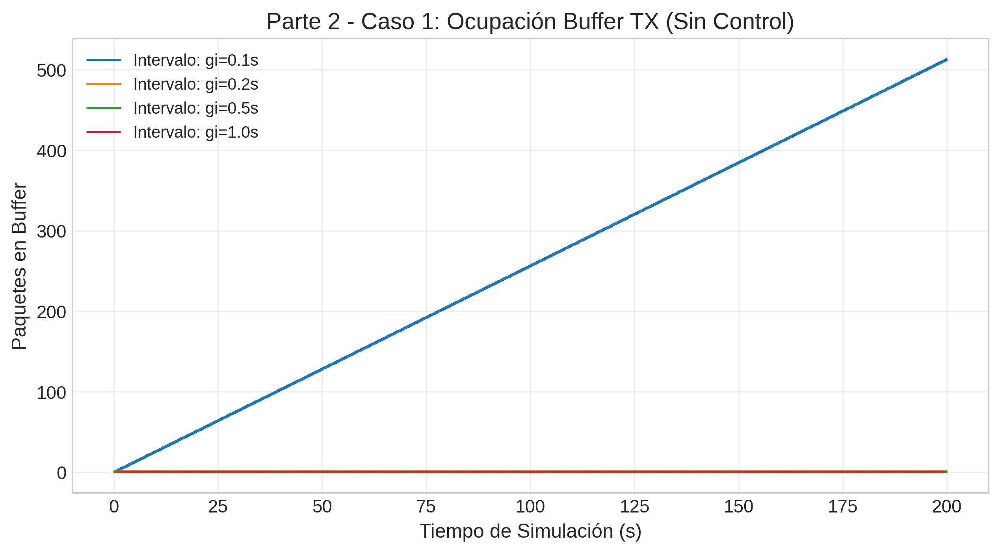
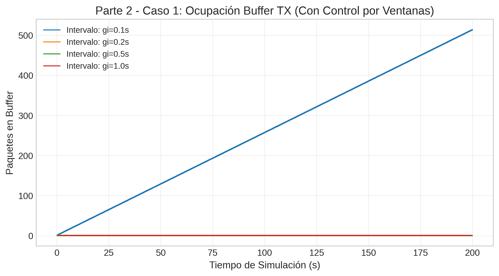
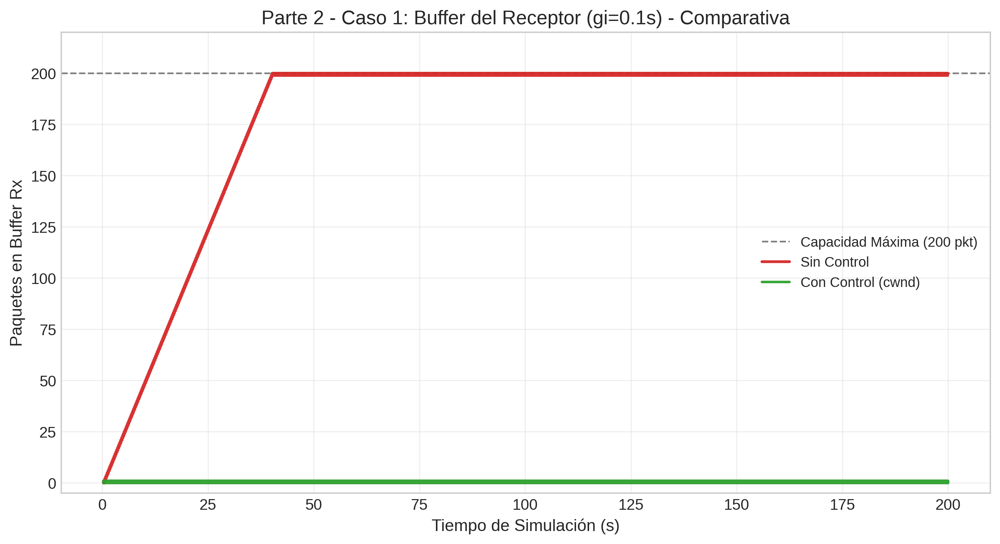
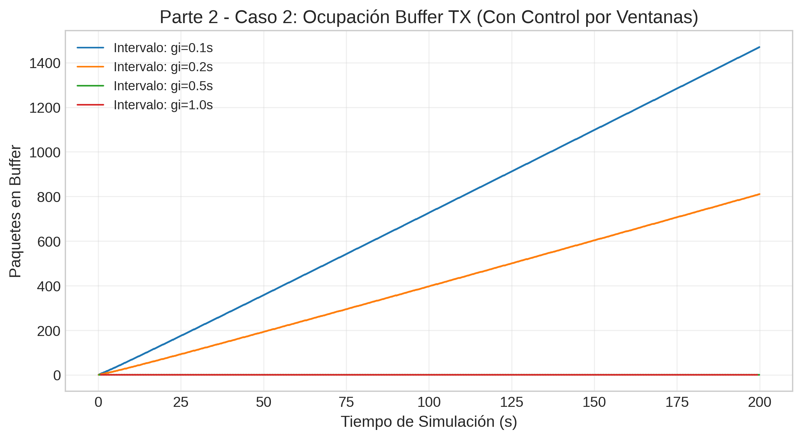
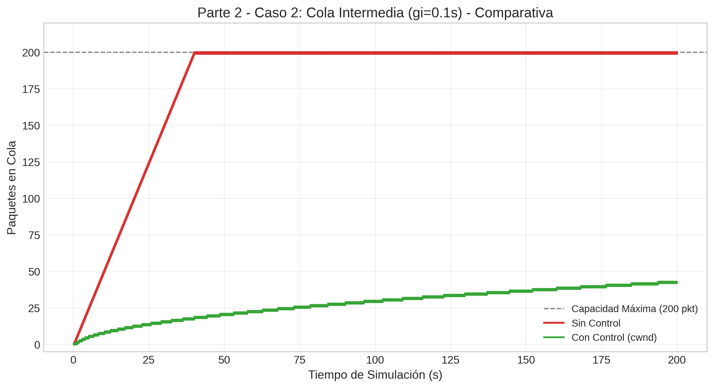
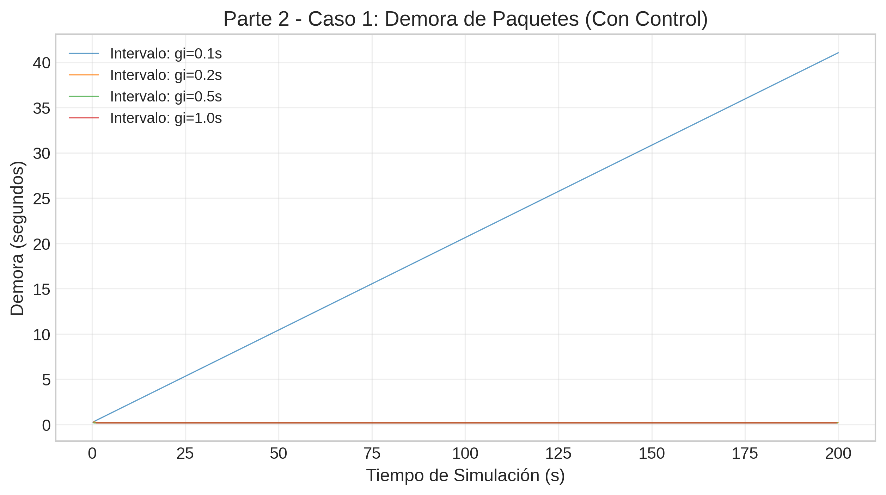
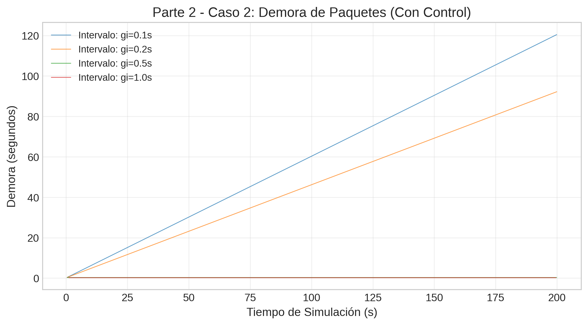

# Laboratorio 3: Transporte

Redes y Sistemas Distribuidos - **FaMAF** - **UNC**

## Integrantes
* Álvarez, Lis Ailín
* Pinilla, Lautaro
* Sabino, Lucas

---

## Índice
1. [Resumen Breve](#1-resumen-breve)
2. [Introducción](#2-introducción-problema-a-estudiar)
3. [Métodos](#3-métodos-modelo-y-parámetros)
4. [Resultados](#4-resultados-gráficas-y-observaciones)
5. [Discusión y Preguntas de Análisis](#5-discusión-e-interpretación)
6. [Conclusiones](#6-conclusiones)
7. [Anexo: Uso de Herramientas de Inteligencia Artificial](#7-anexo-uso-de-herramientas-de-inteligencia-artificial)
8. [Reproducibilidad de los Experimentos](#8-reproducibilidad-de-los-experimentos)

---

## 1. Resumen Breve

### 1.1. Resumen Parte 1

En esta primera parte del laboratorio se implementó y analizó un modelo computacional de red de paquetes mediante simulación de eventos discretos en el entorno OMNeT++. El desarrollo consistió en la definición de una topología lineal compuesta por un nodo transmisor (`NodeTx`), una cola intermedia que emula el enrutamiento de la red (`Network.queue`), y un nodo receptor (`NodeRx`) provisto de un sumidero de consumo final (`Sink`). 

Para modelar un entorno físico realista, se programaron paquetes con un tamaño fijo de 12,500 bytes (100 kbits) empleando la clase `cPacket`, y se establecieron restricciones estructurales estrictas: una capacidad de almacenamiento finito acotada a 200 paquetes para los buffers intermedio y de recepción, junto con tasas de transmisión determinísticas (datarates) en los enlaces de comunicación.

Sobre esta arquitectura, se ejecutó un análisis experimental variando la carga ofrecida mediante el intervalo de generación exponencial de tráfico (con medias de gi igual a 0.1s, 0.2s, 0.5s y 1.0s). El objetivo fue contrastar dos escenarios de saturación independientes: el Caso 1, donde el cuello de botella físico se ubica en la tasa de consumo del receptor final (evaluando dinámicas de Control de Flujo), y el Caso 2, donde la restricción de datarate radica en el enlace intermedio (evaluando dinámicas de Control de Congestión). El análisis de las series temporales extraídas permitió verificar los regímenes de estabilidad e inestabilidad predichos por la teoría de colas, identificando con precisión la ubicación de los desbordamientos de memoria y su impacto en el rendimiento efectivo (throughput) de la red.

### Resumen Parte 2
[COMPLETAR]

---

## 2. Introducción

### 2.1. Contexto y Objetivos 

En una red de paquetes, el problema de fondo es simple: no siempre se puede enviar datos al ritmo que uno quiere. Si los enlaces tienen tasa limitada y los buffers son finitos, empiezan las colas, las demoras y, eventualmente, las pérdidas.

En transporte, para este laboratorio nos enfocamos en dos situaciones:

* **Control de Flujo:** pasa cuando el receptor procesa más lento que lo que le llega. El emisor debería bajar su ritmo para no desbordar el buffer de recepción.

* **Congestión:** pasa cuando la red intermedia (enlaces/colas) no alcanza a transportar toda la carga ofrecida. En ese caso, los nodos de la red se llenan y empiezan los descartes.

**Objetivos** <br>
En la primera parte del trabajo de laboratorio utilizamos la simulación para estudiar estos problemas de transporte, con el foco puesto en analizar e interpretar el comportamiento físico de la red ante enlaces acotados y memoria finita. Los objetivos específicos planteados para esta etapa intermedia son:
* Leer, modificar y extender modelos de red en OMNeT++.
* Modelar paquetes con tamaño en bytes y enlaces con tasas de transmisión.
* Medir demora, ocupación de buffers y pérdida de paquetes.
* Distinguir entre problemas de control de flujo y problemas de control de congestión.
* Analizar resultados experimentales y justificar conclusiones en un informe.

Ya para la segunda parte se incorporó una estrategia de control por ventanas inspirada en TCP, sin modificar la tasa de generación del emisor. La idea fue que `TransportTx` regule cuántos paquetes puede mantener en vuelo usando una ventana efectiva, para reducir la saturación de buffers y las pérdidas asociadas.

**Objetivos Parte 2** <br>
* Implementar un mecanismo de control por ventanas en `TransportTx`.
* Limitar la cantidad de paquetes en vuelo mediante `cwnd`, `rwnd` y `effectiveWindow`.
* Comparar el comportamiento con y sin control en ambos casos de estudio.
* Analizar el efecto del control sobre pérdidas, ocupación de buffers, demora y rendimiento.


---

## 3. Métodos: Modelo y Parámetros

### 3.1. Arquitectura Base y Parametrización

Para el estudio experimental se implementó un modelo de red lineal basado en simulación de eventos discretos utilizando el entorno OMNeT++. La arquitectura se estructuró de forma modular definiendo componentes simples en C++ y estableciendo sus relaciones topológicas mediante el lenguaje de descripción de red (`.ned`). El sistema completo (`Network`) se compone de tres etapas de procesamiento en cascada: un nodo de transmisión (`NodeTx`), una cola de enrutamiento intermedia (`queue`) y un nodo de recepción final (`NodeRx`).

#### 3.1.1. Descripción Estructural de los Módulos

La topología y la lógica de envío se implementan con tres módulos heredados de `cSimpleModule`:

* **Módulo Generador (`Generator`):** Es la fuente de tráfico en `NodeTx`. Crea objetos `cPacket` con tamaño en bytes (`packetByteSize`) y usa un temporizador (`sendMsgEvent`) para generar paquetes con intervalo exponencial.
* **Módulo de Encolamiento (`Queue`):** Implementa una cola FIFO de capacidad finita. Se usa en tres lugares: `nodeTx.txBuffer`, `Network.queue` y `nodeRx.rxBuffer`.
    * *Servicio:* cuando llega un paquete y el servidor está libre, se agenda `endServiceEvent`. El tiempo de transmisión se calcula como $t_{\text{tx}} = \frac{L}{R}$ usando el canal de salida.
    * *Descartes:* si la cola alcanzó `bufferSize`, el paquete se descarta, se registra en `packetDropVector` y se libera memoria con `delete`.
* **Módulo Sumidero (`Sink`):** Es la etapa final en `NodeRx`. Recibe paquetes, registra métricas de entrega/demora y destruye el objeto para liberar recursos.

#### 3.1.2. Parametrización Base

| Parámetro | Valor base | Dentro del código |
|---|---|---|
| Tiempo de simulación | $200\text{ s}$ | `sim-time-limit` |
| Tamaño de paquete | $12{,}500\text{ Bytes}$ ($100{,}000\text{ bits}$) | `Network.nodeTx.gen.packetByteSize` |
| Intervalo medio de generación | $gi \in \{0.1, 0.2, 0.5, 1.0\}\text{ s}$ | `*.nodeTx.gen.generationInterval = exponential(${gi=0.1,0.2,0.5,1.0})` |
| Distribución de generación | Exponencial | `exponential(...)` |
| Tamaño del buffer transmisor | $2 \times 10^6$ paquetes (arbitrariamente alto) | `Network.nodeTx.txBuffer.bufferSize` |
| Tamaño del buffer intermedio | $200$ paquetes | `Network.queue.bufferSize` |
| Tamaño del buffer receptor | $200$ paquetes | `Network.nodeRx.rxBuffer.bufferSize` |
| Delay de enlaces entre nodos | $100\ \mu\text{s}$ | `Network.linkDelay` (valor por defecto en `network.ned`) |

El intervalo de generación se dejó como parámetro variable (`gi`) para poder correr simulaciones paramétricas. Además, la tasa de entrada se calcula como $R_{\text{in}} = \frac{L}{gi}$; para los valores usados, equivale a $1.0$, $0.5$, $0.2$ y $0.1\text{ Mbps}$.

#### 3.1.3. Definición de los Casos de Estudio

En `omnetpp.ini` se definieron dos casos para aislar el origen del cuello de botella:

| Caso | Objetivo | `txToQueueDatarate` | `queueToRxDatarate` | `rxToSinkDatarate` | Cuello de botella esperado |
|---|---|---:|---:|---:|---|
| Caso 1 | Control de flujo | $1\text{ Mbps}$ | $1\text{ Mbps}$ | $0.5\text{ Mbps}$ | Receptor (`NodeRx` $\rightarrow$ `Sink`) |
| Caso 2 | Control de congestión | $1\text{ Mbps}$ | $0.5\text{ Mbps}$ | $1\text{ Mbps}$ | Red intermedia (`Network.queue` $\rightarrow$ `NodeRx`) |

En ambos casos, la carga ofrecida se controla con `gi`, y la diferencia clave es dónde se ubica la restricción de tasa.

### 3.2. Extensión para la Parte 2: Control por Ventanas

Para la segunda parte del laboratorio se extendió el modelo de transporte con un control por ventanas inspirado en TCP, pero simplificado para este trabajo. La idea fue que `TransportTx` no envíe inmediatamente todo lo recibido del generador, sino que mantenga un buffer de transmisión y autorice el envío solo cuando la cantidad de paquetes en vuelo lo permita.

La ventana efectiva se define como el mínimo entre la ventana de congestión (`cwnd`) y la ventana anunciada por el receptor (`rwnd`):

$$
effectiveWindow = \min(cwnd, rwnd)
$$

De ese modo, el transmisor regula su ritmo sin cambiar la tasa de producción del generador.

En esta segunda parte también se incorporaron nuevos módulos y atributos para soportar el control por ventanas:

* **`TransportTx`**: mantiene `bufferSize`, `cwnd`, `rwnd`, `effectiveWindow` e `inFlight`, y decide cuándo enviar o esperar.
* **`TransportRx`**: genera ACKs y actualiza `rwnd`; además puede propagar la señal de congestión.
* **Atributos de control en los mensajes**: `ecn`, `rwnd` y la información de actualización de ventana asociada a los ACKs.
* **Mensajes de control**: ACK por paquete y `WINDOW_UPDATE` cuando el receptor recupera espacio libre.

### 3.3. Retroalimentación y Métricas de la Parte 2

La retroalimentación viaja en ACKs generados por `TransportRx`. Esos mensajes transportan la información necesaria para actualizar la ventana del transmisor y reflejan el estado del receptor y de la red. Cuando corresponde, también se propaga una señal de congestión para que `TransportTx` reduzca su envío.

Para esta parte se registraron además nuevas métricas temporales:
* `rwnd`: ventana disponible en el receptor.
* `cwnd`: ventana de congestión del transmisor.
* `effectiveWindow`: ventana efectiva usada para autorizar el envío.
* `inFlight`: paquetes actualmente en vuelo.

Estas variables permiten describir el mecanismo de control sin entrar todavía en el análisis detallado de sus ventajas y limitaciones.

### 3.4. Libertades de Diseño del Control por Ventanas

Además de los elementos obligatorios del modelo, para la Parte 2 se tomaron algunas decisiones de diseño propias para simplificar el mecanismo y hacerlo estable en este laboratorio. En particular, se adoptó `ACK` por paquete, una reducción multiplicativa de `cwnd` ante congestión, y una actualización directa de `rwnd` a partir del estado del receptor. También se evitó implementar retransmisión, ya que el objetivo principal fue regular el envío para prevenir pérdidas y no recuperarlas después.


---

## 4. Resultados: Gráficas y Observaciones

### 4.1. Resultados Experimentales (Parte 1)

Los datos crudos de las simulaciones fueron extraídos desde los vectores temporales de OMNeT++ hacia archivos CSV (`caso1_sin_control.csv` y `caso2_sin_control.csv`). A continuación se presentan las gráficas de las métricas obligatorias para los distintos intervalos de generación ($gi \in \{0.1\text{s}, 0.2\text{s}, 0.5\text{s}, 1.0\text{s}\}$).

#### 4.1.1. Ocupación del Buffer de Transmisión (`nodeTx.txBuffer`)

##### Caso 1 (Control de Flujo)


##### Caso 2 (Control de Congestión)


> **Observación:** En ambos casos de estudio, para el intervalo de generación más rápido ($gi = 0.1\text{ s}$), se observa una recta de ocupación que crece de manera monótona a lo largo de toda la simulación, acumulando un máximo de **513 paquetes** en $t = 200\text{ s}$. Para los intervalos restantes ($gi \ge 0.2\text{ s}$), la ocupación se mantiene estrictamente constante en **0 paquetes**.

---

#### 4.1.2. Ocupación de la Cola Intermedia (`Network.queue`)

##### Caso 1 (Control de Flujo) — Vista Macro y Zoom Detallado


##### Caso 2 (Control de Congestión) — Vista Estándar


> **Observaciones:**
> * **En el Caso 1:** La vista completa (0 a 200 s) exhibe un bloque sólido de color entre los valores 0 y 1 debido al aliasing. Si observamos el registro haciendo un zoom de 10 a 15 s, se revela el comportamiento real: la ocupación oscila entre **0 y 1 paquete**. A medida que aumenta el parámetro $gi$, disminuye drásticamente la frecuencia de pulsos, observándose mayores períodos de inactividad plana en 0 entre el procesamiento de cada paquete.
> * **En el Caso 2:** Para las inyecciones rápidas de $gi = 0.1\text{ s}$ y $gi = 0.2\text{ s}$, la curva crece velozmente hasta llegar al límite físico de la cola de **200 paquetes**, manteniéndose en este valor techo. Para $gi \ge 0.5\text{ s}$, la ocupación permanece estable y cercana a 0.

---

#### 4.1.3. Ocupación del Buffer de Recepción (`nodeRx.rxBuffer`)

##### Caso 1 (Control de Flujo) — Vista Estándar


##### Caso 2 (Control de Congestión) — Vista Macro y Zoom Detallado


> **Observaciones:**
> * **En el Caso 1:** La ocupación para $gi = 0.1\text{ s}$ trepa de forma casi instantánea hasta el límite máximo de **200 paquetes**, quedándose en ese techo. Para $gi = 0.2\text{ s}$, la curva también alcanza el límite de 200 paquetes pero de forma más gradual. Con $gi \ge 0.5\text{ s}$, la cola permanece plana sin acumulación.
> * **En el Caso 2:** La vista completa también presenta aliasing. Al hacer zoom se observa el comportamiento real: el búfer oscila entre **0 y 1 paquete** (ráfagas breves), sin acumulación sostenida. Para valores mayores de $gi$, esos pulsos aparecen con menor frecuencia.

---

#### 4.1.4. Tasa Acumulada de Paquetes Descartados (`packetDrops`)

##### Caso 1 (Control de Flujo)


##### Caso 2 (Control de Congestión)


> **Observaciones:** 
> * **En el Caso 1:** Las pérdidas ocurren de manera exclusiva en el búfer del receptor (`nodeRx.rxBuffer`), registrándose curvas ascendentes que acumulan un total de **799 paquetes descartados** para $gi = 0.1\text{ s}$ y **652 paquetes descartados** para $gi = 0.2\text{ s}$. El resto de los nodos presenta cero pérdidas.
> * **En el Caso 2:** Las pérdidas ocurren de manera exclusiva en la cola intermedia de la red (`Network.queue`), arrojando exactamente los mismos recuentos acumulados (**799 y 652 paquetes perdidos**) para las corridas de $0.1\text{ s}$ y $0.2\text{ s}$. El búfer del receptor no descarta paquetes.

---

#### 4.1.5. Carga Ofrecida vs. Carga Útil Recibida (Throughput)

##### Caso 1 (Control de Flujo)


##### Caso 2 (Control de Congestión)


> **Observación:** En ambos experimentos, se observa que la carga útil recibida crece con una relación lineal idéntica a la carga ofrecida en el tramo de 1 a 5 paquetes por segundo. Al alcanzar la carga ofrecida de **10 paquetes/s** ($gi = 0.1\text{ s}$), la curva experimenta un quiebre y se aplana estrictamente de forma horizontal sobre la cota del límite de enlace físico de **5 paquetes/s**.

---

### 4.2. Resultados Experimentales (Parte 2)

En la segunda parte se reutilizaron los mismos parámetros y los mismos dos casos de estudio, pero ahora comparando el comportamiento sin control frente al comportamiento con control por ventanas. Esta sección queda preparada para incorporar las figuras pedidas en el punto 7 y luego apoyar la discusión de la Parte 2.

#### 4.2.1. Ocupación de Buffers

##### Caso 1: Sin control vs. con control




##### Caso 2: Sin control vs. con control




> **Nota:** en el Caso 1 la comparación del cuello de botella se hace sobre el receptor (`nodeRx`); en el Caso 2, sobre la cola intermedia (`Network.queue`).

#### 4.2.2. Pérdidas de Paquetes

##### Caso 1


##### Caso 2


#### 4.2.3. Carga Ofrecida vs. Carga Útil

La figura final de esta subsección debería permitir comparar, en una sola gráfica, al menos cuatro curvas: Caso 1 sin control, Caso 1 con control, Caso 2 sin control y Caso 2 con control. Si se añade una curva de límite teórico, debe explicarse que corresponde al throughput máximo impuesto por el enlace de menor tasa.

#### 4.2.4. Demora




#### 4.2.5. Evolución de las Variables de Control


> **Nota:** cuando estén disponibles las series de `rwnd` y `effectiveWindow`, conviene agregarlas en esta misma subsección para mostrar la ventana anunciada, la ventana de congestión y la ventana efectiva en una sola comparación.

---


## 5. Discusión e Interpretación

### 5.1. Respuestas a las Preguntas de Análisis (Parte 1)

#### 1. ¿Qué diferencias observan entre el Caso 1 y el Caso 2?
La diferencia principal es **dónde se forma la cola que se llena**.

En el **Caso 1**, la red intermedia no se satura (la cola `Network.queue` oscila entre 0 y 1), pero el receptor consume más lento ($0.5\text{ Mbps}$). Por eso la acumulación fuerte aparece en `nodeRx.rxBuffer`, y ahí se producen los descartes.

En el **Caso 2**, el cuello está antes, en la red: `queueToRxDatarate = 0.5Mbps`. Entonces la acumulación y las pérdidas pasan en `Network.queue`. El `rxBuffer` no acumula: en zoom se ve que oscila en pulsos cortos entre 0 y 1.

Además, en ambos casos pasa algo parecido con la carga: para $gi = 0.2\text{ s}$ el sistema queda al límite y aparecen saturaciones por variabilidad de la fuente exponencial; para $gi \ge 0.5\text{ s}$ el comportamiento es estable y sin pérdidas. También en ambos casos el `txBuffer` crece solo para $gi = 0.1\text{ s}$.

#### 2. ¿Cuál es la fuente limitante en cada caso?
La fuente limitante es el tramo que quedó en $0.5\text{ Mbps}$ (equivale a $5$ paquetes/s con paquetes de $100{,}000$ bits):

* **Caso 1:** limita el receptor, por `rxToSinkDatarate = 0.5Mbps`.
* **Caso 2:** limita la red intermedia, por `queueToRxDatarate = 0.5Mbps`.

#### 3. ¿En qué caso se observa un problema de control de flujo y en cuál uno de control de congestión?
* En el **Caso 1** hay **control de flujo**: el receptor es más lento que lo que le llega, entonces se llena su buffer.
* En el **Caso 2** hay **control de congestión**: el problema está en la red intermedia, que no alcanza a transportar todo el tráfico ofrecido.

#### 4. ¿Qué evidencia experimental usan para sostener esa conclusión?
Nos basamos en tres evidencias claras:

1. **Dónde se llena la cola:** en Caso 1 llega a 200 paquetes `nodeRx.rxBuffer`; en Caso 2 llega a 200 paquetes `Network.queue`.
2. **Vistas con zoom:** el nodo que no está limitado se mantiene estable, con pulsos cortos entre 0 y 1 paquete.
3. **Dónde hay pérdidas (`packetDrops`):** en Caso 1 los descartes aparecen en el receptor; en Caso 2 aparecen en la cola intermedia. Los valores máximos (799 para $gi=0.1\text{ s}$ y 652 para $gi=0.2\text{ s}$) coinciden con esa interpretación.

---

## 6. Conclusiones

### 6.1. Conclusiones de Análisis Físico (Parte 1)

En esta parte del laboratorio pudimos comprobar, con simulaciones, la diferencia entre un problema de **control de flujo** y uno de **control de congestión**. Aunque los dos casos tienen métricas globales parecidas (mismo límite de throughput y cantidades de descarte muy similares), la diferencia importante está en **qué nodo se satura**.

En el **Caso 1**, el cuello está en el receptor (`rxToSinkDatarate = 0.5Mbps`), por eso se llena `nodeRx.rxBuffer` y ahí aparecen los descartes. En el **Caso 2**, el cuello está en la red intermedia (`queueToRxDatarate = 0.5Mbps`), por eso se llena `Network.queue` y las pérdidas se mueven a ese nodo.

También vimos que:
* para $gi = 0.1\text{ s}$ la red entra claramente en sobrecarga;
* para $gi = 0.2\text{ s}$ queda en el límite y la variabilidad de la fuente exponencial alcanza para generar saturación;
* para $gi \ge 0.5\text{ s}$ el sistema opera estable y sin pérdidas.

Como cierre, el modelo implementado en OMNeT++ resultó consistente con lo esperado por teoría de colas para este tipo de escenarios y permitió ubicar de forma clara dónde se produce el problema en cada caso.

---

## 7. Anexo: Uso de Herramientas de Inteligencia Artificial

Para el desarrollo de este laboratorio se emplearon asistentes basados en Modelos de Lenguaje (LLMs).

* **Herramientas utilizadas:** Gemini (Google).
* **Propósito:** Desarrollo de scripts en Python para la conversión de datos y trazado de gráficas, y consultas sobre el funcionamiento de OMNeT++.
* **Interacciones relevantes:** Discusión de las gráficas obtenidas y mejoras/correcciones (generación de vistas ampliadas) en los casos donde se presentó aliasing.
* **Validación:** Las gráficas generadas fueron analizadas para ver si realmente coincidían con lo que se esperaba teóricamente que pase.

---

## 8. Reproducibilidad de los Experimentos

Para extraer los datos y generar los reportes de la **Parte 1** de forma automatizada, situarse en el directorio raíz del proyecto y ejecutar la siguiente secuencia en una terminal:

```bash
# 1. Activación del entorno virtual y variables de entorno de OMNeT++
source ~/omnetpp-6.3.0/setenv

# 2. Compilación del modelo fuente C++
make

# 3. Limpieza de registros anteriores y ejecución de los casos de estudio en modo consola (Cmdenv)
rm -rf results/*
./lab3-kickstarter -u Cmdenv -c Caso1
./lab3-kickstarter -u Cmdenv -c Caso2

# 4. Extracción de datos vectoriales y escalares hacia archivos CSV
opp_scavetool export -o caso1.csv results/Caso1-*.vec results/Caso1-*.sca
opp_scavetool export -o caso2.csv results/Caso2-*.vec results/Caso2-*.sca

# 5. Generación de trazados gráficos y reportes de rendimiento
python3 analisis.py
```