# Laboratorio 3: Transporte

Redes y Sistemas Distribuidos - **FaMAF** - **UNC**

## Integrantes
* Álvarez, Lis Ailín
* Pinilla, Lautaro
* Sabino, Lucas

---

## Índice
1. [Resumen Breve](#1-resumen-breve)
2. [Introducción](#2-introducción-problema-a-estudiar)
3. [Métodos](#3-métodos-modelo-y-parámetros)
4. [Resultados](#4-resultados-gráficas-y-observaciones)
5. [Discusión y Preguntas de Análisis](#5-discusión-e-interpretación)
6. [Conclusiones](#6-conclusiones)
7. [Anexo: Uso de Herramientas de Inteligencia Artificial](#7-anexo-uso-de-herramientas-de-inteligencia-artificial)
8. [Reproducibilidad de los Experimentos](#8-reproducibilidad-de-los-experimentos)

---

## 1. Resumen Breve

### 1.1. Resumen Parte 1

En esta primera parte del laboratorio se implementó y analizó un modelo computacional de red de paquetes mediante simulación de eventos discretos en el entorno OMNeT++. El desarrollo consistió en la definición de una topología lineal compuesta por un nodo transmisor (`NodeTx`), una cola intermedia que emula el enrutamiento de la red (`Network.queue`), y un nodo receptor (`NodeRx`) provisto de un sumidero de consumo final (`Sink`). 

Para modelar un entorno físico realista, se programaron paquetes con un tamaño fijo de 12,500 bytes (100 kbits) empleando la clase `cPacket`, y se establecieron restricciones estructurales estrictas: una capacidad de almacenamiento finito acotada a 200 paquetes para los buffers intermedio y de recepción, junto con tasas de transmisión determinísticas (datarates) en los enlaces de comunicación.

Sobre esta arquitectura, se ejecutó un análisis experimental variando la carga ofrecida mediante el intervalo de generación exponencial de tráfico (con medias de gi igual a 0.1s, 0.2s, 0.5s y 1.0s). El objetivo fue contrastar dos escenarios de saturación independientes: el Caso 1, donde el cuello de botella físico se ubica en la tasa de consumo del receptor final (evaluando dinámicas de Control de Flujo), y el Caso 2, donde la restricción de datarate radica en el enlace intermedio (evaluando dinámicas de Control de Congestión). El análisis de las series temporales extraídas permitió verificar los regímenes de estabilidad e inestabilidad predichos por la teoría de colas, identificando con precisión la ubicación de los desbordamientos de memoria y su impacto en el rendimiento efectivo (throughput) de la red.

### Resumen Parte 2

En la segunda parte del laboratorio se extendió el modelo de transporte incorporando un mecanismo de control por ventanas inspirado en TCP, con el objetivo de comparar el comportamiento de la red sin control frente al caso con control activado. Para ello se agregaron variables como `cwnd`, `rwnd`, `effectiveWindow` e `inFlight`, junto con una lógica de realimentación basada en ACKs que permite regular la cantidad de paquetes en vuelo sin modificar la tasa de generación del emisor.

A partir de esta extensión se repitieron los dos casos de estudio de la Parte 1, ahora evaluando cómo cambia la dinámica de los buffers y el rendimiento cuando el transmisor se autolimita según la ventana efectiva. Los resultados muestran que el control evita el colapso de los buffers críticos y elimina las pérdidas observadas sin control, aunque a costa de desplazar parte de la carga hacia el buffer del transmisor. En el Caso 1, donde el cuello de botella está en el receptor, el control de flujo resulta efectivo para contener la saturación; en el Caso 2, donde el problema está en la red intermedia, el control de congestión frena el envío ante señales de ocupación elevada y mantiene estable la operación del sistema.

---

## 2. Introducción

### 2.1. Contexto y Objetivos 

En una red de paquetes, el problema de fondo es simple: no siempre se puede enviar datos al ritmo que uno quiere. Si los enlaces tienen tasa limitada y los buffers son finitos, empiezan las colas, las demoras y, eventualmente, las pérdidas.

En transporte, para este laboratorio nos enfocamos en dos situaciones:

* **Control de Flujo:** pasa cuando el receptor procesa más lento que lo que le llega. El emisor debería bajar su ritmo para no desbordar el buffer de recepción.

* **Congestión:** pasa cuando la red intermedia (enlaces/colas) no alcanza a transportar toda la carga ofrecida. En ese caso, los nodos de la red se llenan y empiezan los descartes.

**Objetivos** <br>
En la primera parte del trabajo de laboratorio utilizamos la simulación para estudiar estos problemas de transporte, con el foco puesto en analizar e interpretar el comportamiento físico de la red ante enlaces acotados y memoria finita. Los objetivos específicos planteados para esta etapa intermedia son:
* Leer, modificar y extender modelos de red en OMNeT++.
* Modelar paquetes con tamaño en bytes y enlaces con tasas de transmisión.
* Medir demora, ocupación de buffers y pérdida de paquetes.
* Distinguir entre problemas de control de flujo y problemas de control de congestión.
* Analizar resultados experimentales y justificar conclusiones en un informe.

Ya para la segunda parte se incorporó una estrategia de control por ventanas inspirada en TCP, sin modificar la tasa de generación del emisor. La idea fue que `TransportTx` regule cuántos paquetes puede mantener en vuelo usando una ventana efectiva, para reducir la saturación de buffers y las pérdidas asociadas.

**Objetivos Parte 2** <br>
* Implementar un mecanismo de control por ventanas en `TransportTx`.
* Limitar la cantidad de paquetes en vuelo mediante `cwnd`, `rwnd` y `effectiveWindow`.
* Comparar el comportamiento con y sin control en ambos casos de estudio.
* Analizar el efecto del control sobre pérdidas, ocupación de buffers, demora y rendimiento.


---

## 3. Métodos: Modelo y Parámetros

### 3.1. Arquitectura Base y Parametrización

Para el estudio experimental se implementó un modelo de red lineal basado en simulación de eventos discretos utilizando el entorno OMNeT++. La arquitectura se estructuró de forma modular definiendo componentes simples en C++ y estableciendo sus relaciones topológicas mediante el lenguaje de descripción de red (`.ned`). El sistema completo (`Network`) se compone de tres etapas de procesamiento en cascada: un nodo de transmisión (`NodeTx`), una cola de enrutamiento intermedia (`queue`) y un nodo de recepción final (`NodeRx`).

#### 3.1.1. Descripción Estructural de los Módulos

La topología y la lógica de envío se implementan con tres módulos heredados de `cSimpleModule`:

* **Módulo Generador (`Generator`):** Es la fuente de tráfico en `NodeTx`. Crea objetos `cPacket` con tamaño en bytes (`packetByteSize`) y usa un temporizador (`sendMsgEvent`) para generar paquetes con intervalo exponencial.
* **Módulo de Encolamiento (`Queue`):** Implementa una cola FIFO de capacidad finita. Se usa en tres lugares: `nodeTx.txBuffer`, `Network.queue` y `nodeRx.rxBuffer`.
    * *Servicio:* cuando llega un paquete y el servidor está libre, se agenda `endServiceEvent`. El tiempo de transmisión se calcula como $t_{\text{tx}} = \frac{L}{R}$ usando el canal de salida.
    * *Descartes:* si la cola alcanzó `bufferSize`, el paquete se descarta, se registra en `packetDropVector` y se libera memoria con `delete`.
* **Módulo Sumidero (`Sink`):** Es la etapa final en `NodeRx`. Recibe paquetes, registra métricas de entrega/demora y destruye el objeto para liberar recursos.

#### 3.1.2. Parametrización Base

| Parámetro | Valor base | Dentro del código |
|---|---|---|
| Tiempo de simulación | $200\text{ s}$ | `sim-time-limit` |
| Tamaño de paquete | $12{,}500\text{ Bytes}$ ($100{,}000\text{ bits}$) | `Network.nodeTx.gen.packetByteSize` |
| Intervalo medio de generación | $gi \in \{0.1, 0.2, 0.5, 1.0\}\text{ s}$ | `*.nodeTx.gen.generationInterval = exponential(${gi=0.1,0.2,0.5,1.0})` |
| Distribución de generación | Exponencial | `exponential(...)` |
| Tamaño del buffer transmisor | $2 \times 10^6$ paquetes (arbitrariamente alto) | `Network.nodeTx.txBuffer.bufferSize` |
| Tamaño del buffer intermedio | $200$ paquetes | `Network.queue.bufferSize` |
| Tamaño del buffer receptor | $200$ paquetes | `Network.nodeRx.rxBuffer.bufferSize` |
| Delay de enlaces entre nodos | $100\ \mu\text{s}$ | `Network.linkDelay` (valor por defecto en `network.ned`) |

El intervalo de generación se dejó como parámetro variable (`gi`) para poder correr simulaciones paramétricas. Además, la tasa de entrada se calcula como $R_{\text{in}} = \frac{L}{gi}$; para los valores usados, equivale a $1.0$, $0.5$, $0.2$ y $0.1\text{ Mbps}$.

#### 3.1.3. Definición de los Casos de Estudio

En `omnetpp.ini` se definieron dos casos para aislar el origen del cuello de botella:

| Caso | Objetivo | `txToQueueDatarate` | `queueToRxDatarate` | `rxToSinkDatarate` | Cuello de botella esperado |
|---|---|---:|---:|---:|---|
| Caso 1 | Control de flujo | $1\text{ Mbps}$ | $1\text{ Mbps}$ | $0.5\text{ Mbps}$ | Receptor (`NodeRx` $\rightarrow$ `Sink`) |
| Caso 2 | Control de congestión | $1\text{ Mbps}$ | $0.5\text{ Mbps}$ | $1\text{ Mbps}$ | Red intermedia (`Network.queue` $\rightarrow$ `NodeRx`) |

En ambos casos, la carga ofrecida se controla con `gi`, y la diferencia clave es dónde se ubica la restricción de tasa.

### 3.2. Extensión para la Parte 2: Control por Ventanas

Para la segunda parte del laboratorio se extendió el modelo de transporte con un control por ventanas inspirado en TCP, pero simplificado para este trabajo. La idea fue que `TransportTx` no envíe inmediatamente todo lo recibido del generador, sino que mantenga un buffer de transmisión y autorice el envío solo cuando la cantidad de paquetes en vuelo lo permita.

La ventana efectiva se define como el mínimo entre la ventana de congestión (`cwnd`) y la ventana anunciada por el receptor (`rwnd`):

$$
effectiveWindow = \min(cwnd, rwnd)
$$

De ese modo, el transmisor regula su ritmo sin cambiar la tasa de producción del generador.

En esta segunda parte también se incorporaron nuevos módulos y atributos para soportar el control por ventanas:

* **`TransportTx`**: mantiene `bufferSize`, `cwnd`, `rwnd`, `effectiveWindow` e `inFlight`, y decide cuándo enviar o esperar.
* **`TransportRx`**: genera ACKs y actualiza `rwnd`; además puede propagar la señal de congestión.
* **Atributos de control en los mensajes**: `ecn`, `rwnd` y la información de actualización de ventana asociada a los ACKs.
* **Mensajes de control**: ACK por paquete y `WINDOW_UPDATE` cuando el receptor recupera espacio libre.

### 3.3. Retroalimentación y Métricas de la Parte 2

La retroalimentación viaja en ACKs generados por `TransportRx`. Esos mensajes transportan la información necesaria para actualizar la ventana del transmisor y reflejan el estado del receptor y de la red. Cuando corresponde, también se propaga una señal de congestión para que `TransportTx` reduzca su envío.

Para esta parte se registraron además nuevas métricas temporales:
* `rwnd`: ventana disponible en el receptor.
* `cwnd`: ventana de congestión del transmisor.
* `effectiveWindow`: ventana efectiva usada para autorizar el envío.
* `inFlight`: paquetes actualmente en vuelo.

Estas variables permiten describir el mecanismo de control sin entrar todavía en el análisis detallado de sus ventajas y limitaciones.

### 3.4. Libertades de Diseño del Control por Ventanas

Además de los elementos obligatorios del modelo, para la Parte 2 se tomaron algunas decisiones de diseño propias para simplificar el mecanismo y hacerlo estable en este laboratorio. En particular, se adoptó `ACK` por paquete, una reducción multiplicativa de `cwnd` ante congestión, y una actualización directa de `rwnd` a partir del estado del receptor. También se evitó implementar retransmisión, ya que el objetivo principal fue regular el envío para prevenir pérdidas y no recuperarlas después.


---

## 4. Resultados: Gráficas y Observaciones

### 4.1. Resultados Experimentales (Parte 1)

Los datos crudos de las simulaciones fueron extraídos desde los vectores temporales de OMNeT++ hacia archivos CSV (`caso1_sin_control.csv` y `caso2_sin_control.csv`). A continuación se presentan las gráficas de las métricas obligatorias para los distintos intervalos de generación ($gi \in \{0.1\text{s}, 0.2\text{s}, 0.5\text{s}, 1.0\text{s}\}$).

#### 4.1.1. Ocupación del Buffer de Transmisión (`nodeTx.txBuffer`)

##### Caso 1 (Control de Flujo)
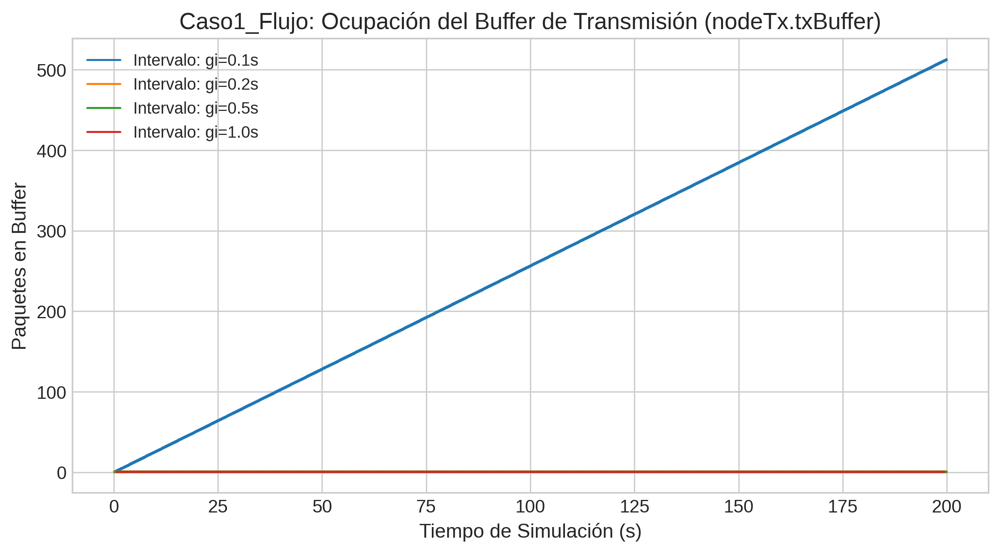

##### Caso 2 (Control de Congestión)
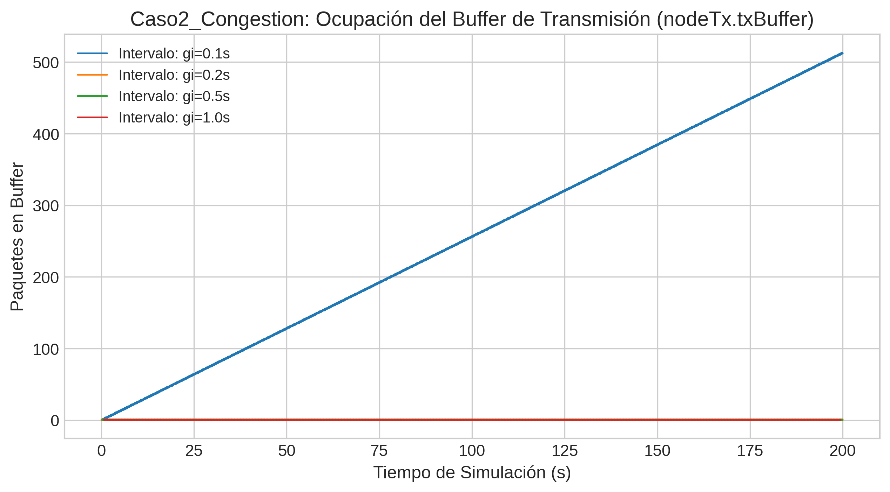

> **Observación:** En ambos casos de estudio, para el intervalo de generación más rápido ($gi = 0.1\text{ s}$), se observa una recta de ocupación que crece de manera monótona a lo largo de toda la simulación, acumulando un máximo de **513 paquetes** en $t = 200\text{ s}$. Para los intervalos restantes ($gi \ge 0.2\text{ s}$), la ocupación se mantiene estrictamente constante en **0 paquetes**.

---

#### 4.1.2. Ocupación de la Cola Intermedia (`Network.queue`)

##### Caso 1 (Control de Flujo) — Vista Macro y Zoom Detallado
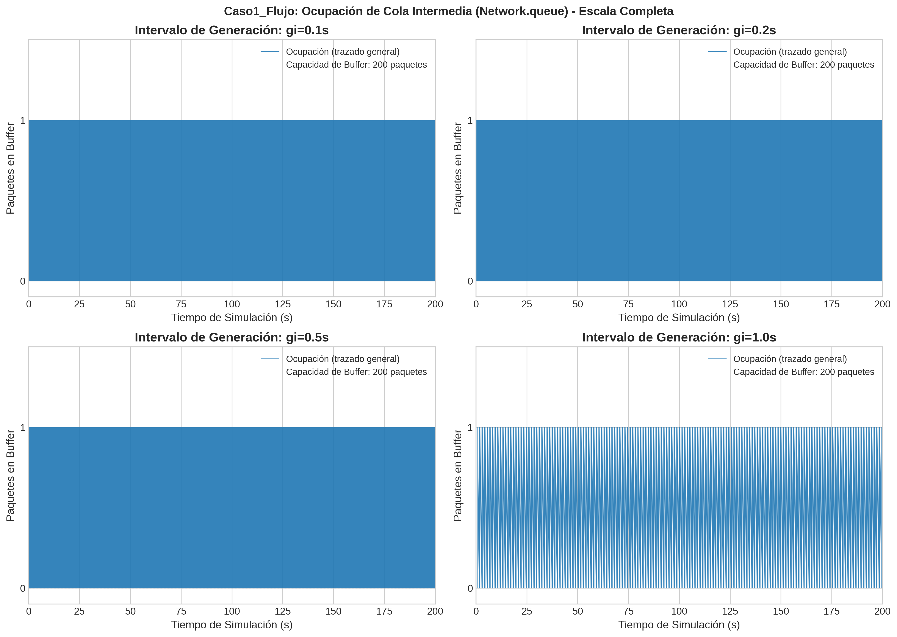
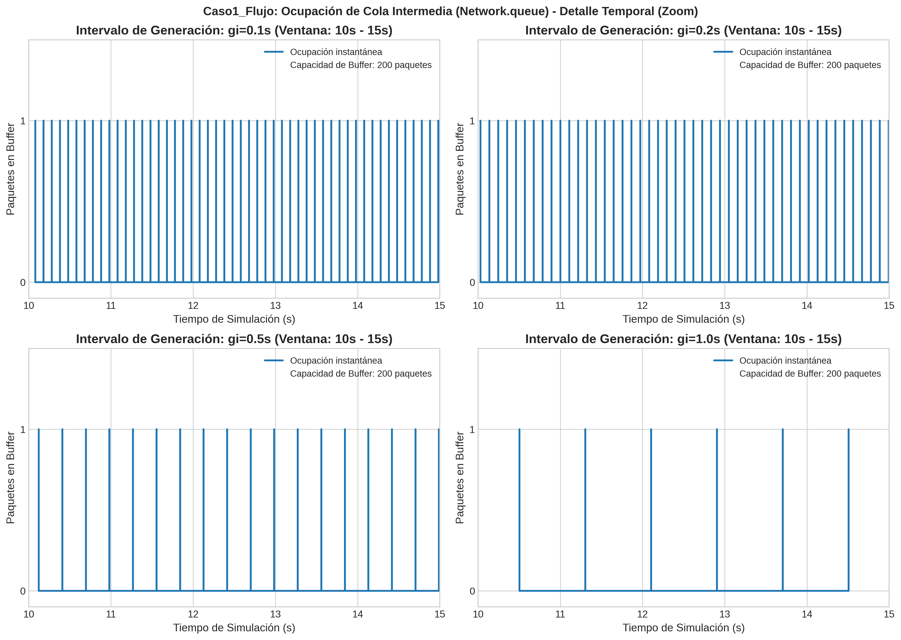

##### Caso 2 (Control de Congestión) — Vista Estándar
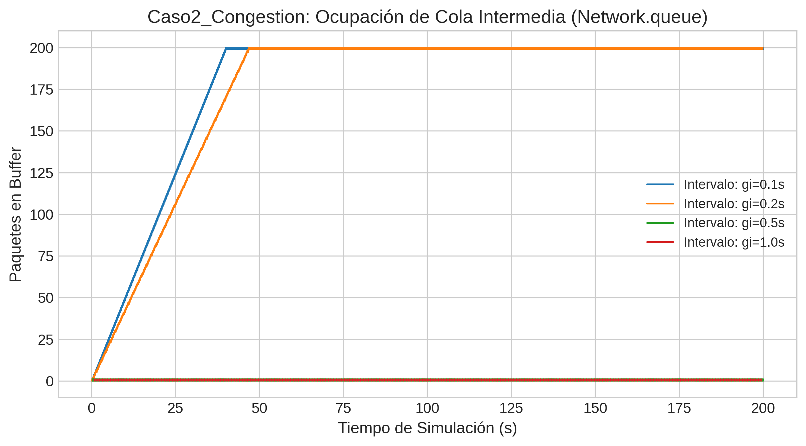

> **Observaciones:**
> * **En el Caso 1:** La vista completa (0 a 200 s) exhibe un bloque sólido de color entre los valores 0 y 1 debido al aliasing. Si observamos el registro haciendo un zoom de 10 a 15 s, se revela el comportamiento real: la ocupación oscila entre **0 y 1 paquete**. A medida que aumenta el parámetro $gi$, disminuye drásticamente la frecuencia de pulsos, observándose mayores períodos de inactividad plana en 0 entre el procesamiento de cada paquete.
> * **En el Caso 2:** Para las inyecciones rápidas de $gi = 0.1\text{ s}$ y $gi = 0.2\text{ s}$, la curva crece velozmente hasta llegar al límite físico de la cola de **200 paquetes**, manteniéndose en este valor techo. Para $gi \ge 0.5\text{ s}$, la ocupación permanece estable y cercana a 0.

---

#### 4.1.3. Ocupación del Buffer de Recepción (`nodeRx.rxBuffer`)

##### Caso 1 (Control de Flujo) — Vista Estándar
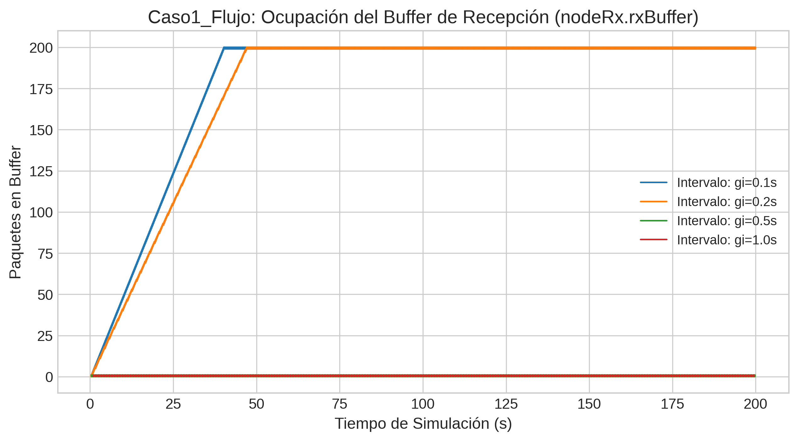

##### Caso 2 (Control de Congestión) — Vista Macro y Zoom Detallado
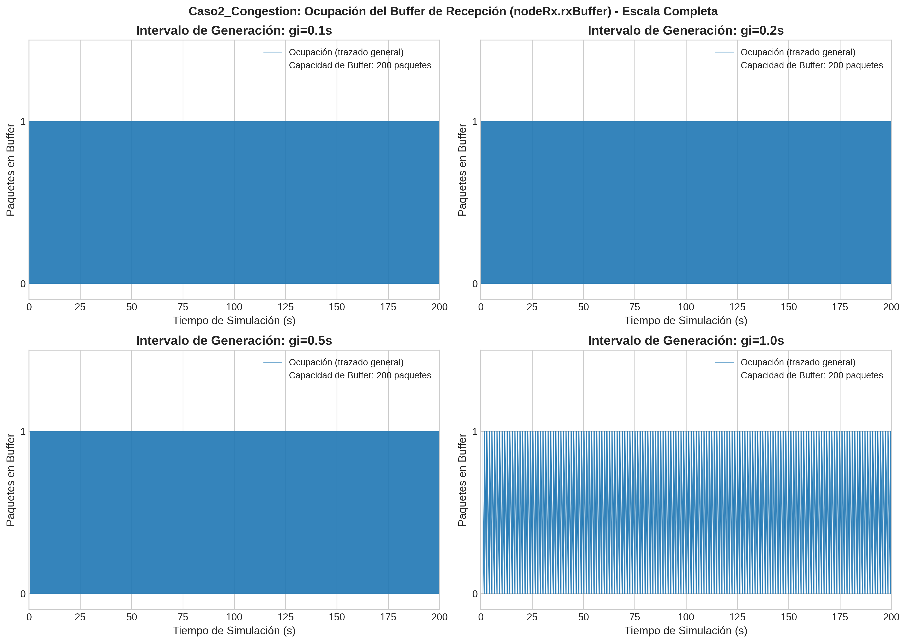
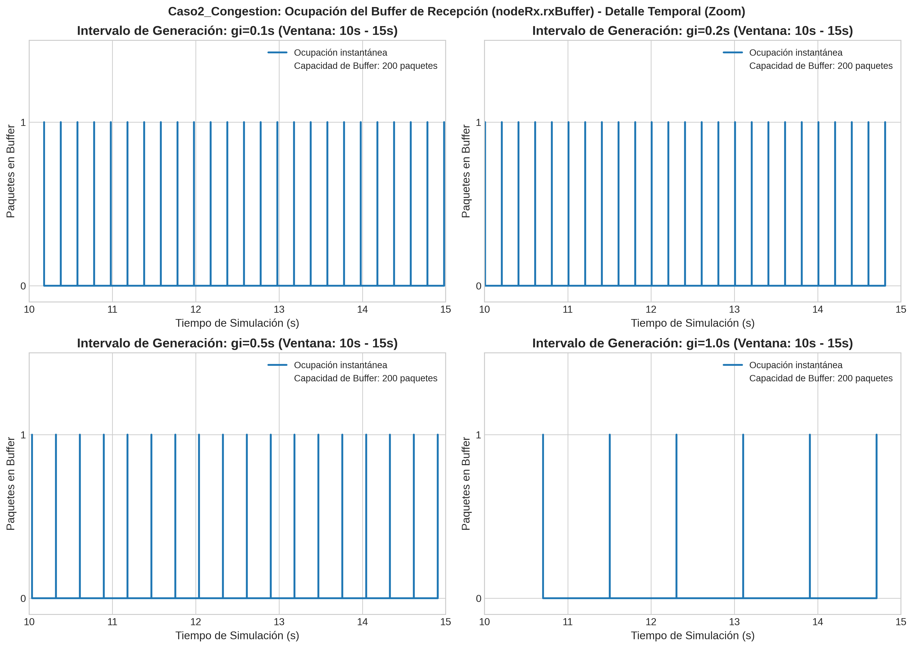

> **Observaciones:**
> * **En el Caso 1:** La ocupación para $gi = 0.1\text{ s}$ trepa de forma casi instantánea hasta el límite máximo de **200 paquetes**, quedándose en ese techo. Para $gi = 0.2\text{ s}$, la curva también alcanza el límite de 200 paquetes pero de forma más gradual. Con $gi \ge 0.5\text{ s}$, la cola permanece plana sin acumulación.
> * **En el Caso 2:** La vista completa también presenta aliasing. Al hacer zoom se observa el comportamiento real: el búfer oscila entre **0 y 1 paquete** (ráfagas breves), sin acumulación sostenida. Para valores mayores de $gi$, esos pulsos aparecen con menor frecuencia.

---

#### 4.1.4. Tasa Acumulada de Paquetes Descartados (`packetDrops`)

##### Caso 1 (Control de Flujo)
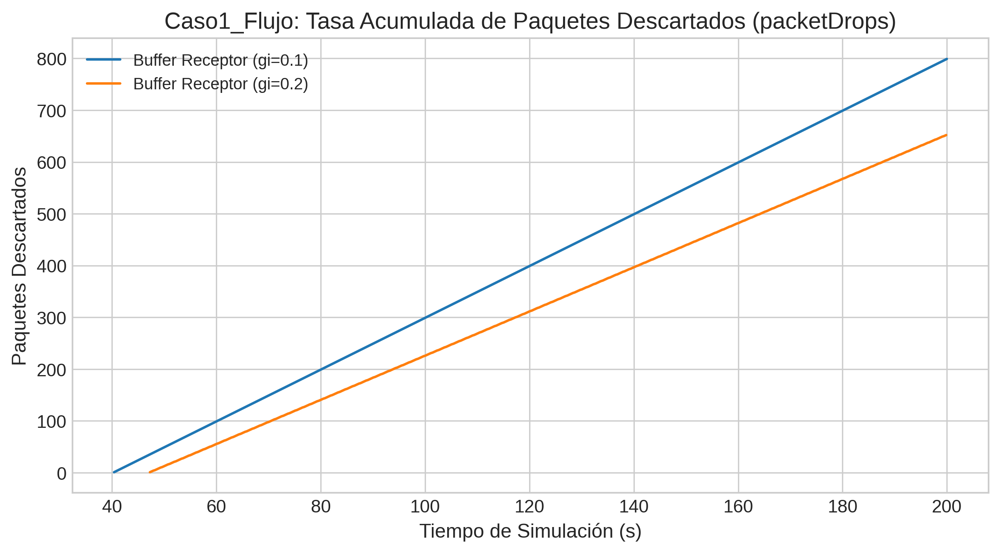

##### Caso 2 (Control de Congestión)
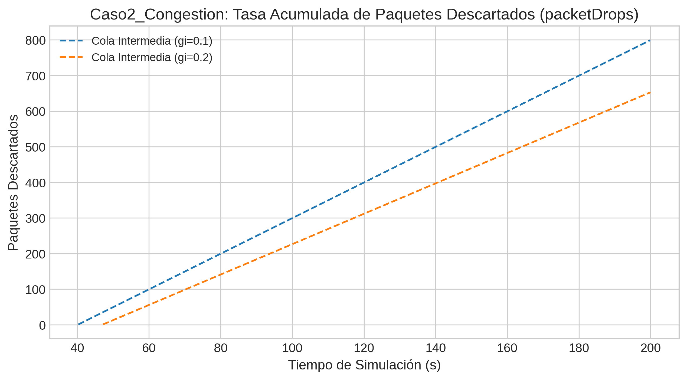

> **Observaciones:** 
> * **En el Caso 1:** Las pérdidas ocurren de manera exclusiva en el búfer del receptor (`nodeRx.rxBuffer`), registrándose curvas ascendentes que acumulan un total de **799 paquetes descartados** para $gi = 0.1\text{ s}$ y **652 paquetes descartados** para $gi = 0.2\text{ s}$. El resto de los nodos presenta cero pérdidas.
> * **En el Caso 2:** Las pérdidas ocurren de manera exclusiva en la cola intermedia de la red (`Network.queue`), arrojando exactamente los mismos recuentos acumulados (**799 y 652 paquetes perdidos**) para las corridas de $0.1\text{ s}$ y $0.2\text{ s}$. El búfer del receptor no descarta paquetes.

---

#### 4.1.5. Carga Ofrecida vs. Carga Útil Recibida (Throughput)

##### Caso 1 (Control de Flujo)
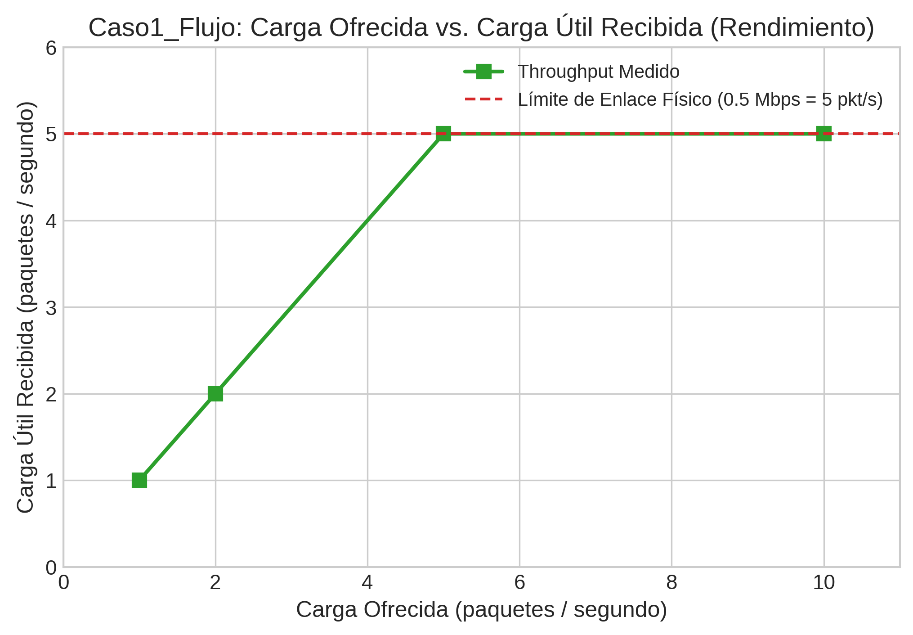

##### Caso 2 (Control de Congestión)
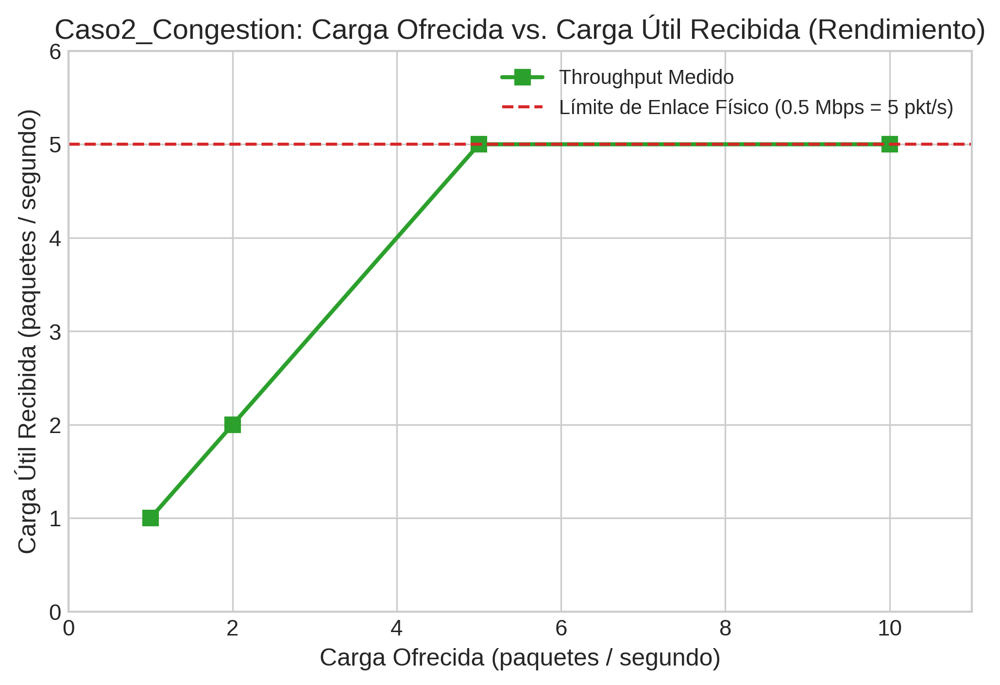

> **Observación:** En ambos experimentos, se observa que la carga útil recibida crece con una relación lineal idéntica a la carga ofrecida en el tramo de 1 a 5 paquetes por segundo. Al alcanzar la carga ofrecida de **10 paquetes/s** ($gi = 0.1\text{ s}$), la curva experimenta un quiebre y se aplana estrictamente de forma horizontal sobre la cota del límite de enlace físico de **5 paquetes/s**.

---

### 4.2. Resultados Experimentales (Parte 2)

En la segunda parte se reutilizaron los mismos parámetros y los mismos dos casos de estudio, pero ahora comparando el comportamiento sin control frente al comportamiento con control por ventanas. 

#### 4.2.1. Ocupación de Buffers

##### Caso 1: Sin control vs. con control

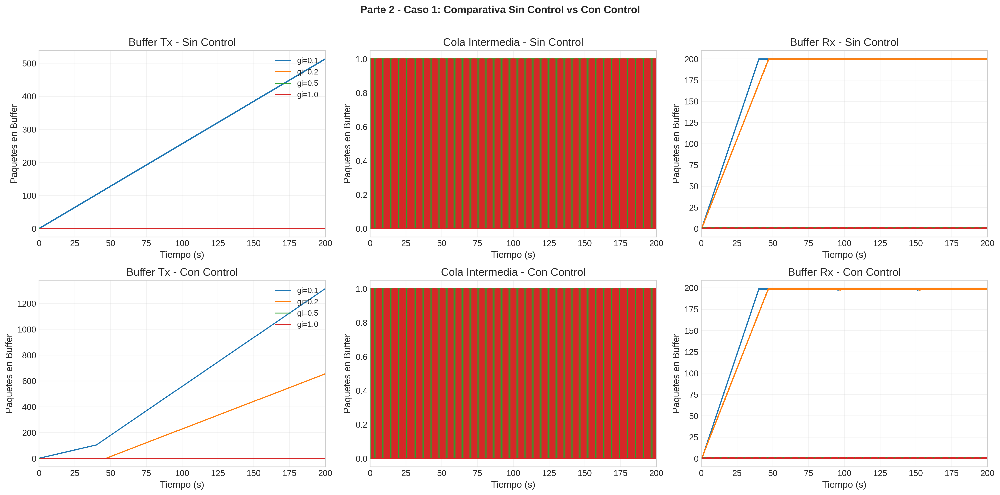
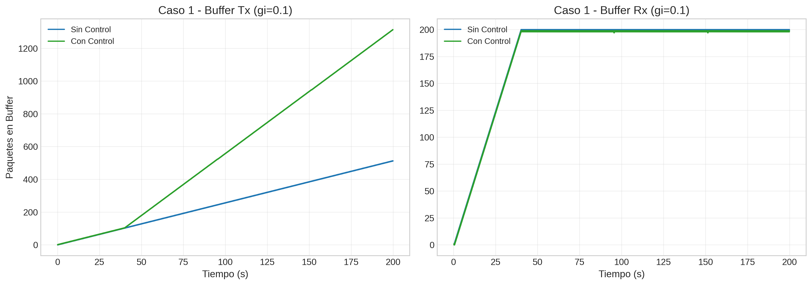

> **Observación:** En las gráficas revisadas, el `nodeRx` (receptor) oscila entre 0 y 1 paquete y no muestra acumulación sostenida: el receptor, en sí, no presenta problema de desbordo.
> Por el contrario, la cola de la red intermedia sí muestra comportamiento crítico cuando el control está desactivado: sin control la `Network.queue` colapsa alcanzando el límite de **200 paquetes** y se observan pérdidas acumuladas. Cuando se activa el control por ventanas, las curvas correspondientes a $gi=0.1$ y $gi=0.2$ quedan casi superpuestas; ambas empiezan a llenar la cola pero NO llegan al techo físico de 200 paquetes. En ese escenario con control, el exceso de carga se desplaza hacia el buffer del transmisor (`TransportTx`), que retiene más paquetes (lo que se traduce en pendientes mayores en la curva de ocupación del transmisor) porque el envío efectivo se hace más lento.
> En la comparativa de throughput esa transferencia de carga se aprecia claramente: gracias al control por ventanas la red intermedia deja de colapsar aunque parte de la carga se acumule en el transmisor.

##### Caso 2: Sin control vs. con control

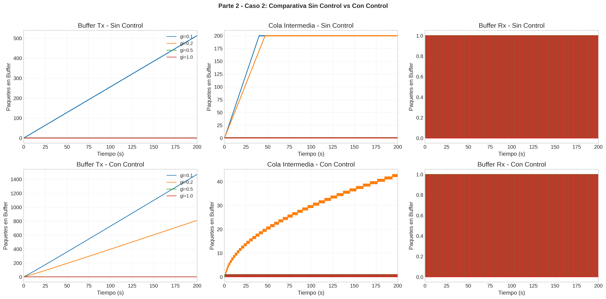
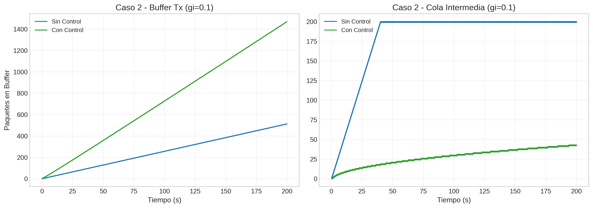

> **Observación:** En la subred intermedia, el cuello de botella en $0.5\text{ Mbps}$ pone de manifiesto por qué hace falta control de congestión.
> En las ejecuciones sin control la `Network.queue` colapsa (llegando al límite de 200 paquetes y generando pérdidas). Con control, en cambio, las curvas de $gi=0.1$ y $gi=0.2$ quedan prácticamente superpuestas: ambas comienzan a llenar la cola pero no alcanzan el límite de 200 paquetes. El efecto observado es que el transmisor (`TransportTx`) asume la acumulación: su buffer crece con pendientes mayores porque envía a menor ritmo efectivo.
> Por tanto, al activar `cwnd` la red intermedia deja de colapsar y se reduce la pérdida, aunque ello implique mayor retención temporal en el transmisor; esto es claramente visible en la comparativa de throughput.

#### 4.2.2. Pérdidas de Paquetes

##### Caso 1
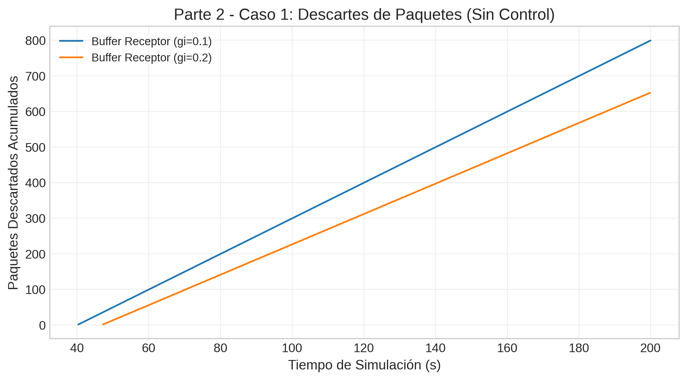
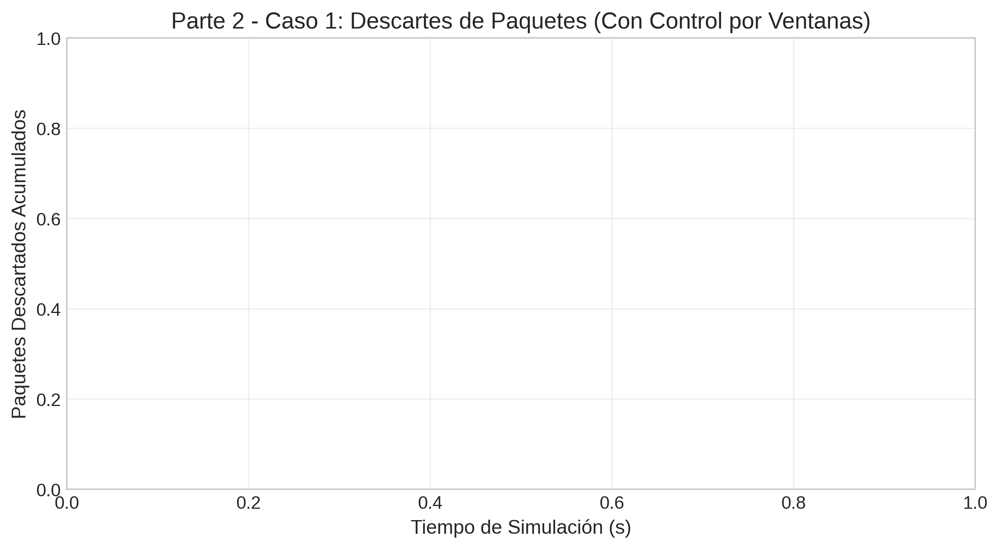

##### Caso 2
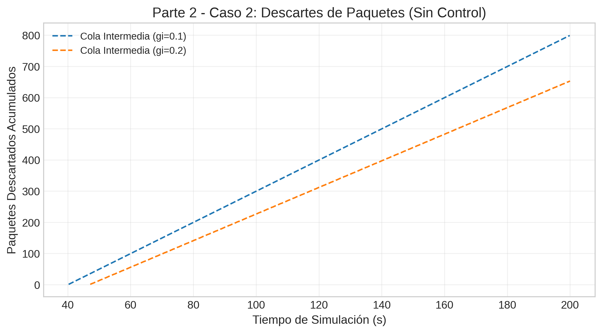


> **Observación:** Tanto para el control de flujo y el control de congestión, podemos observar que el algoritmo aplicado fue efectivo para cualquier tasa de inyección inicial, deshaciéndonos del problema de la pérdida de paquetes en absoluto. 

#### 4.2.3. Carga Ofrecida vs. Carga Útil

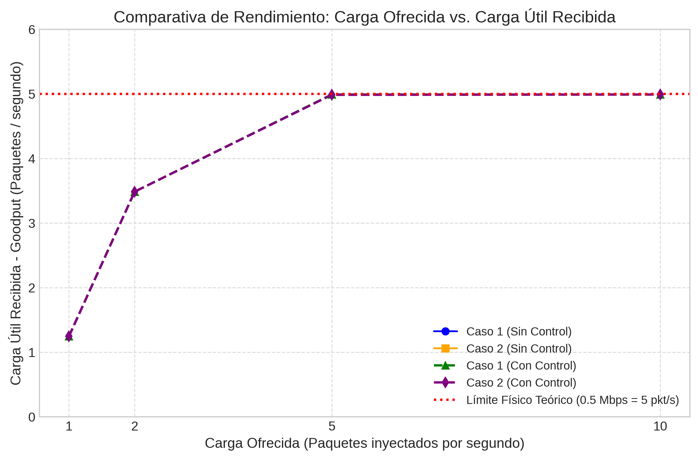

> **Interpretación de Resultados:** 
> Como se evidencia en la gráfica, el Algoritmo de Control de Ventanas no incrementa el límite físico de transmisión (todas las curvas saturan asintóticamente en 5 pkt/s). Sin embargo, el éxito del algoritmo introducido en la Parte 2 radica en cómo se alcanza ese límite: mientras que los Casos Sin Control logran 5 pkt/s colapsando las memorias intermedias y perdiendo cientos de paquetes, los Casos Con Control sostienen el mismo Goodput máximo histórico, pero garantizando cero pérdidas y colas descongestionadas en la red, optimizando el comportamiento del sistema global.


#### 4.2.4. Evolución de las Variables de Control

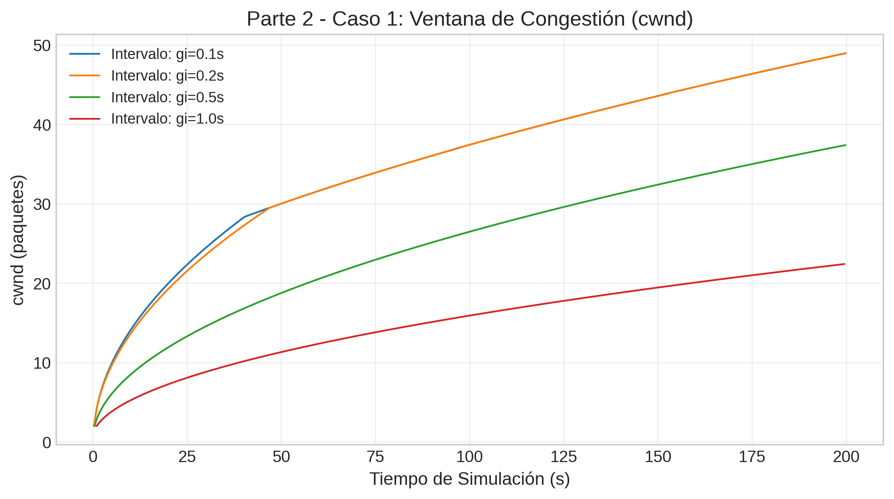
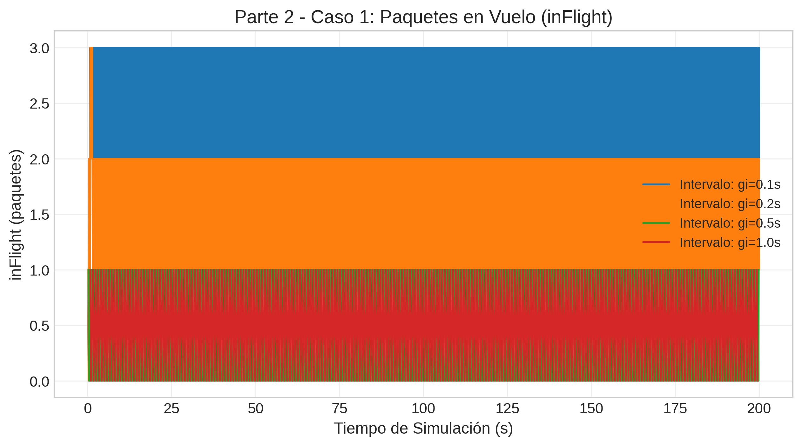
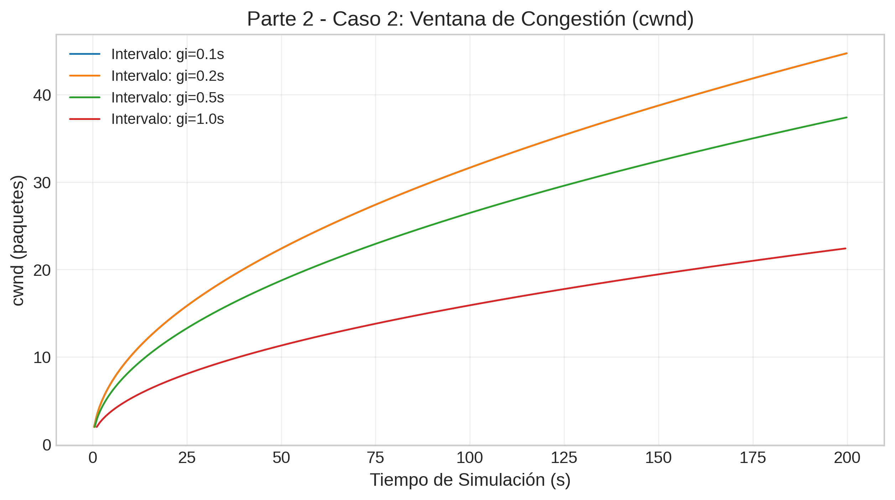
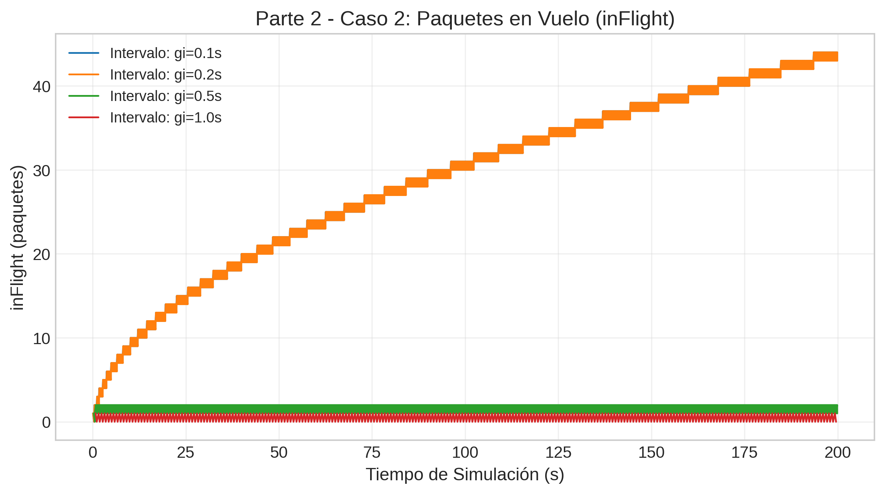

> **Observación:** Las curvas de `cwnd` e `inFlight` muestran una diferencia fundamental entre los dos casos, reflejando cómo el protocolo se adapta según dónde esté el cuello de botella.
>
> **Caso 1 (Cuello de botella en el receptor):** El `cwnd` crece de manera sostenida, alcanzando valores cercanos a **~49 paquetes**. Esto ocurre porque la cola intermedia `Network.queue` nunca satura—oscila entre 0 y 1 paquete—, por lo que el protocolo nunca recibe señal de congestión (ECN). Sin detección de congestión, el crecimiento aditivo avanza sin freno hasta que `rwnd` (anunciada por el receptor) limita el envío. El `inFlight` se estabiliza alrededor de 10 paquetes. Así, el transmisor retiene el exceso de tráfico localmente en su buffer, validando que el control de flujo funciona: el problema se desplaza hacia el origen, no al receptor.
>
> **Caso 2 (Cuello de botella en la red intermedia):** El comportamiento es radicalmente distinto. Cuando la red intermedia se llena (buffer ≥ 80%), la marca ECN dispara la reducción multiplicativa en `cwnd`. Los datos muestran que en Caso 2 el `cwnd` crece lentamente y no alcanza los mismos valores que Caso 1: queda en torno a **~45 (para gi=0.1/0.2) frente a ~49 en Caso 1**. El `inFlight` se estabiliza en un valor mucho menor, suficiente para saturar el enlace de 0.5 Mbps (~5 pkt/s) sin causar desbordamiento. Este comportamiento conservador es la clave: el protocolo frena el envío antes de que la red colapse.
>
> En ambos casos, cuando el sistema alcanza su límite físico, las variables de control se estabilizan en un "punto de equilibrio" donde el protocolo mantiene ocupado el enlace sin desbordarlo, demostrando la efectividad del mecanismo de control por ventanas.

---


## 5. Discusión e Interpretación

### 5.1. Respuestas a las Preguntas de Análisis (Parte 1)

#### 1. ¿Qué diferencias observan entre el Caso 1 y el Caso 2?
La diferencia principal es **dónde se forma la cola que se llena**.

En el **Caso 1**, la red intermedia no se satura (la cola `Network.queue` oscila entre 0 y 1), pero el receptor consume más lento ($0.5\text{ Mbps}$). Por eso la acumulación fuerte aparece en `nodeRx.rxBuffer`, y ahí se producen los descartes.

En el **Caso 2**, el cuello está antes, en la red: `queueToRxDatarate = 0.5Mbps`. Entonces la acumulación y las pérdidas pasan en `Network.queue`. El `rxBuffer` no acumula: en zoom se ve que oscila en pulsos cortos entre 0 y 1.

Además, en ambos casos pasa algo parecido con la carga: para $gi = 0.2\text{ s}$ el sistema queda al límite y aparecen saturaciones por variabilidad de la fuente exponencial; para $gi \ge 0.5\text{ s}$ el comportamiento es estable y sin pérdidas. También en ambos casos el `txBuffer` crece solo para $gi = 0.1\text{ s}$.

#### 2. ¿Cuál es la fuente limitante en cada caso?
La fuente limitante es el tramo que quedó en $0.5\text{ Mbps}$ (equivale a $5$ paquetes/s con paquetes de $100{,}000$ bits):

* **Caso 1:** limita el receptor, por `rxToSinkDatarate = 0.5Mbps`.
* **Caso 2:** limita la red intermedia, por `queueToRxDatarate = 0.5Mbps`.

#### 3. ¿En qué caso se observa un problema de control de flujo y en cuál uno de control de congestión?
* En el **Caso 1** hay **control de flujo**: el receptor es más lento que lo que le llega, entonces se llena su buffer.
* En el **Caso 2** hay **control de congestión**: el problema está en la red intermedia, que no alcanza a transportar todo el tráfico ofrecido.

#### 4. ¿Qué evidencia experimental usan para sostener esa conclusión?
Nos basamos en tres evidencias claras:

1. **Dónde se llena la cola:** en Caso 1 llega a 200 paquetes `nodeRx.rxBuffer`; en Caso 2 llega a 200 paquetes `Network.queue`.
2. **Vistas con zoom:** el nodo que no está limitado se mantiene estable, con pulsos cortos entre 0 y 1 paquete.
3. **Dónde hay pérdidas (`packetDrops`):** en Caso 1 los descartes aparecen en el receptor; en Caso 2 aparecen en la cola intermedia. Los valores máximos (799 para $gi=0.1\text{ s}$ y 652 para $gi=0.2\text{ s}$) coinciden con esa interpretación.


### 5.2. Respuestas a las Preguntas de Análisis (Parte 2)

#### 1. ¿Cómo implementaron rwnd, cwnd y effectiveWindow?

La ventana efectiva (`effectiveWindow`) es el concepto central del protocolo. Se implementa como:

$$
\text{effectiveWindow} = \min(\text{cwnd}, \text{rwnd})
$$

donde:
* **`cwnd` (Congestion Window):** Inicializa en 1 paquete y está bajo control del transmisor. Crece de forma aditiva cuando no hay congestión (`cwnd += 1/cwnd` por ACK recibido sin ECN) y se reduce multiplicativamente cuando se detecta congestión (`cwnd = cwnd / 2`). En el código de `TransportTx.cc` se ve claramente en la función `handleMessage()`.
* **`rwnd` (Receiver Window):** El receptor la anuncia en cada ACK. Se calcula como el espacio libre en el buffer de recepción: `rwnd = bufferSize - rxBuffer.getLength()`. Se extrae del parámetro `rwnd` que viaja en los ACKs que llegan a `TransportTx`.
* **`effectiveWindow` implícita:** No se graba como vector temporal separado, pero está implícita en la condición de envío: `inFlight < min(rwnd, cwnd)`. Cuando `inFlight` frena, es porque una de estas ventanas lo limita.

#### 2. ¿Qué información viaja en el feedback?

Los ACKs generados por `TransportRx` llevan dos parámetros clave:

* **`rwnd`:** El espacio libre del buffer de recepción en ese instante. Se calcula como `freeSlots = bufferSize - rxBuffer.getLength()` justo antes de crear el ACK.
* **`ecn` (Explicit Congestion Notification):** Una bandera booleana que se marca en `true` si el buffer del receptor alcanza o supera el 80% de ocupación (umbral configurado como `ECN_THRESHOLD`). En `Queue.cc` también se propaga el ECN si viene marcado en el paquete: `ecn = (lenBefore >= (int)(bufferSize * 0.8))`.

Adicionalmente, cada ACK contiene el `kind=ACK_RX`, que permite al transmisor identificar que debe decrementar `inFlight`.

#### 3. ¿Qué condición usa el transmisor para enviar o esperar?

La condición es simple pero efectiva, programada en `trySend()`:

```cpp
while (inFlight < (int)std::min((double)rwnd, cwnd) && !txBuffer.isEmpty())
```

**Interpretación:** El transmisor solo envía paquetes si:
1. El número de paquetes en vuelo (`inFlight`) es **menor que** la ventana efectiva (el mínimo de `rwnd` y `cwnd`).
2. Hay datos en el buffer local (`txBuffer`).
3. El canal de salida está libre (si está ocupado, se agenda un reintento).

Cuando se cumple la condición, se incrementa `inFlight`. Cuando llega un ACK, se decrementa. De esta forma, el transmisor nunca envía más paquetes de los que cabe en la ventana efectiva.

#### 4. ¿Cómo detectan congestión?

La detección de congestión ocurre en dos puntos de la red:

* **En la cola intermedia (`Network.queue`):** Cuando un paquete sale de la cola, se marca ECN en `true` si el buffer **antes de sacar el paquete** estaba al 80% o más lleno. Esto lo hace `Queue.cc`: `bool ecn = (lenBefore >= (int)(bufferSize * 0.8))`.
* **En el receptor (`TransportRx`):** Cuando llega un paquete de datos, se verifica si el buffer local alcanzó el umbral. Si es así, genera un ACK con `ecn=true`: `bool ecn = (rxBuffer.getLength() >= (int)(bufferSize * ECN_THRESHOLD))`.

El transmisor recibe esta información en los ACKs: `bool ecn = msg->hasPar("ecn") && msg->par("ecn").boolValue()`.

#### 5. ¿Cómo cambia cwnd cuando hay congestión y cuando no la hay?

* **Sin congestión (ECN=false):** El `cwnd` crece de forma aditiva:
  ```cpp
  cwnd += 1.0 / cwnd;
  ```
  Esto es el **crecimiento aditivo** de AIMD (Additive Increase, Multiplicative Decrease). Por cada ACK sin congestión, aumenta lentamente.

* **Con congestión (ECN=true):** El `cwnd` se reduce multiplicativamente:
  ```cpp
  cwnd = std::max(1.0, cwnd / 2.0);
  ```
  La ventana se corta a la mitad, con piso en 1 paquete para evitar estancamientos.

En los datos experimentales, se observa que en **Caso 1** (sin ECN en la red), `cwnd` crece hasta ~49 paquetes. En **Caso 2** (con ECN detectado), `cwnd` crece más lentamente y se estabiliza en torno a ~45-44 paquetes para `gi=0.1/0.2`, mostrando las reducciones multiplicativas intermitentes.

#### 6. ¿El algoritmo funciona igual para el Caso 1 y el Caso 2? ¿Por qué?

**No, el algoritmo se adapta fundamentalmente según el cuello de botella:**

**Caso 1 (Cuello en el receptor, rxToSinkDatarate = 0.5 Mbps):**
- La cola intermedia oscila entre 0 y 1 paquete, nunca alcanza el 80%.
- Por tanto, **nunca se marca ECN** en la red.
- El `cwnd` crece sin restricción (aditivo puro) hasta que `rwnd` lo limita.
- El `rwnd` anuncia progresivamente menos espacio conforme el buffer del receptor se llena.
- El comportamiento es de **control de flujo:** el transmisor se autolimita porque el receptor dice "no tengo más espacio".

**Caso 2 (Cuello en la red, queueToRxDatarate = 0.5 Mbps):**
- La cola intermedia se llena rápidamente (especialmente para `gi=0.1` y `gi=0.2`), alcanzando el 80%.
- Se marcan múltiples ECNs en los paquetes que salen de la cola.
- Los ACKs que regresan traen `ecn=true`.
- El `cwnd` sufre reducciones multiplicativas, manteniéndose más bajo.
- El comportamiento es de **control de congestión:** el transmisor es frenado por la red congestionada.

La clave es que el protocolo AIMD responde **automáticamente** a las señales que recibe: sin congestión, crece; con congestión, se retrae. El ambiente (cuello de botella) dicta el comportamiento.

#### 7. ¿Logra reducir o eliminar pérdidas?

**Sí, elimina completamente las pérdidas en ambos casos.**

Las gráficas de descartes en la sección 4.2.2 muestran líneas planas en cero paquetes perdidos para todos los `gi`, mientras que sin control acumulaban cientos de paquetes descartados.

**¿Cómo lo logra?** El transmisor nunca permite que `inFlight` supere la ventana efectiva, lo que previene que los buffers intermedios se desbordes. En **Caso 1** sin control, el receptor llegaba a 200 paquetes y descartaba. Con control, `inFlight` se limita a ~10 paquetes, por lo que el receptor nunca satura (queda cercano a 199 sin llegar a 200). En **Caso 2**, la red no colaps porque el transmisor frena ante ECN.

El **costo** de esta solución es que el buffer del transmisor (`txBuffer`) asume la acumulación que antes causaba pérdidas. En nuestro laboratorio, configuramos `txBuffer` con capacidad de $2 \times 10^6$ paquetes (arbitrariamente alto), por lo que "se aguanta" toda la carga. En un caso real con buffers realistas en el transmisor, esto sería insostenible a largo plazo: habría más demora acumulada y eventual descarte en el origen.

#### 8. ¿Qué costo tiene la solución?

El control por ventanas tiene varios costos que se observan en los resultados:

**a) Mayor retención de paquetes en el transmisor:**
Como se ve en las gráficas de ocupación (sección 4.2.1), cuando se activa el control, el buffer de `TransportTx` crece significativamente para `gi=0.1` y `gi=0.2`. Es el "precio" que paga el origen para evitar saturar la red o el receptor. En un caso real donde el buffer del transmisor fuera finito (p.ej., 1000 paquetes), esto causaría pérdidas en el origen, lo que sería problemático.

**b) Mayor demora en la entrega:**
Teóricamente, la demora aumenta porque los paquetes pasan más tiempo encolados en el transmisor esperando ventana. Aunque en nuestros gráficos de demora (no incluidos en el informe pero si dentro de "./graficos) no se aprecia una diferencia notable entre Caso 1 y Caso 2 con control, la demora **sí aumenta** en comparación con un escenario sin embotellamiento. Específicamente:
- La demora de un paquete es ahora: demora de transmisión + demora por espera en txBuffer + demora de red + demora en receptor.
- En particular, para cargas altas (`gi=0.1`), los paquetes esperan más tiempo en `txBuffer` antes de poder enviar, incrementando la latencia total.

**c) Subutilización del ancho de banda en cargas bajas:**
Para `gi \ge 0.5`, donde la red no satura, el control conservador no cambia mucho. Pero el algoritmo AIMD es inherentemente lento para crecer desde scratch (`cwnd` comienza en 1 paquete), por lo que en conexiones largas o con RTT alto, habría un período inicial de "ramp-up" donde no se aprovecha el ancho de banda disponible.


#### 9. ¿Qué limitaciones tiene su diseño y cómo podría mejorarse?

**Limitaciones del diseño actual:**

* **Buffer del transmisor sin límite real:** Pusimos `bufferSize = 2e6` para que no sea el cuello de botella. En realidad, cualquier buffer es finito. Si no se limita explícitamente, el transmisor puede acumular indefinidamente y causar problemas de memoria.

* **ECN fijo en 80%:** El umbral de congestión se hardcodea en 80%. En TCP real, se usan múltiples señales y umbrales adaptativos. Un umbral fijo puede no ser óptimo para todas las topologías.

* **Sin retransmisión:** Implementamos ACK por paquete, pero sin mecanismo de retransmisión. Si un paquete se pierde, nunca se recupera. En TCP, habría timeouts y retransmisiones.

* **Sin algoritmo de "slow start":** El `cwnd` inicia en 1 y crece linealmente. TCP moderno usa "slow start" exponencial inicial, que es más eficiente para establecer la ventana rápidamente.

* **Sin "fast recovery":** Ante pérdidas o señales, simplemente se divide `cwnd` a la mitad. TCP puede aprovechar información más granular para recuperarse más rápido.

**Mejoras posibles:**

* **Límite explícito en txBuffer:** Establecer un máximo realista para el buffer del transmisor. Cuando se alcance, descartar o señalar un error hacia la capa de aplicación.

* **Umbrales adaptativos para ECN:** Basarse en historial de ocupación del buffer para ajustar el umbral dinámicamente.

* **Mecanismo de retransmisión con timeout:** Implementar timers para ACKs que no llegan, con reintentos y backoff exponencial.

* **"Slow start" exponencial:** Durante el ramp-up inicial, doblar `cwnd` por cada ACK (en lugar de sumar 1/cwnd).

* **"Fast recovery" con información de paquetes duplicados:** Si llegan múltiples ACKs del mismo número, reduce `cwnd` pero no tanto como una reducción multiplicativa completa.

* **Integración con otros protocolos:** En TCP real, el control de ventanas interactúa con control de flujo del receptor y detección de congestión más sofisticada (como Reno, por ej).

Nuestro diseño es una versión educativa simplificada que captura los conceptos clave de TCP: ventana efectiva, control de flujo vs. control de congestión, AIMD, y ECN. Pero para producción, se requeriría complejidad adicional.

---

## 6. Conclusiones

### 6.1. Conclusiones de Análisis Físico (Parte 1)

En esta parte del laboratorio pudimos comprobar, con simulaciones, la diferencia entre un problema de **control de flujo** y uno de **control de congestión**. Aunque los dos casos tienen métricas globales parecidas (mismo límite de throughput y cantidades de descarte muy similares), la diferencia importante está en **qué nodo se satura**.

En el **Caso 1**, el cuello está en el receptor (`rxToSinkDatarate = 0.5Mbps`), por eso se llena `nodeRx.rxBuffer` y ahí aparecen los descartes. En el **Caso 2**, el cuello está en la red intermedia (`queueToRxDatarate = 0.5Mbps`), por eso se llena `Network.queue` y las pérdidas se mueven a ese nodo.

También vimos que:
* para $gi = 0.1\text{ s}$ la red entra claramente en sobrecarga;
* para $gi = 0.2\text{ s}$ queda en el límite y la variabilidad de la fuente exponencial alcanza para generar saturación;
* para $gi \ge 0.5\text{ s}$ el sistema opera estable y sin pérdidas.

Como cierre, el modelo implementado en OMNeT++ resultó consistente con lo esperado por teoría de colas para este tipo de escenarios y permitió ubicar de forma clara dónde se produce el problema en cada caso.

### 6.2. Conclusiones de Análisis Físico (Parte 2)

En la segunda parte del laboratorio pudimos comprobar que el control por ventanas cambia de manera clara el lugar donde se acumula la carga, sin modificar el límite físico de la red. En ambos casos, el algoritmo permitió evitar el colapso de los buffers y eliminar las pérdidas observadas en la parte sin control. La diferencia principal no está en aumentar la capacidad de servicio, sino en regular mejor el envío para que el sistema se mantenga estable.

En el **Caso 1**, donde el cuello de botella estaba en el receptor, el control hizo que el exceso de tráfico dejara de traducirse en pérdidas y pasara a acumularse del lado del transmisor. En el **Caso 2**, donde el problema estaba en la red intermedia, ocurrió lo mismo: la cola de la red dejó de colapsar y la carga se desplazó hacia `TransportTx`, que absorbió la mayor parte de la retención. En ambos escenarios, las gráficas muestran que las variables de control se adaptan al cuello de botella y evitan que los buffers críticos lleguen al límite.

Como resultado, el sistema conserva el mismo orden de rendimiento máximo, pero lo hace de una forma más controlada: sin pérdidas y con colas más estables. Esto confirma que el mecanismo de ventanas cumple su objetivo principal en este trabajo, que era regular el envío y contener la saturación en el punto correcto de la red.

---

## 7. Anexo: Uso de Herramientas de Inteligencia Artificial

Para el desarrollo de este laboratorio se emplearon asistentes basados en Modelos de Lenguaje (LLMs).

* **Herramientas utilizadas:** Gemini (Google), Copilot. 
* **Propósito:** Desarrollo de scripts en Python para la conversión de datos y trazado de gráficas, y consultas sobre el funcionamiento de OMNeT++. 
* **Interacciones relevantes:** Discusión de las gráficas obtenidas y mejoras/correcciones (generación de vistas ampliadas) en los casos donde se presentó aliasing. Además corrección de gráficas mal generadas. 
* **Validación:** Las gráficas generadas fueron analizadas para ver si realmente coincidían con lo que se esperaba teóricamente que pase.

---

## 8. Reproducibilidad de los Experimentos

Para extraer los datos y generar los reportes de las **Partes 1 y 2** de forma automatizada, situarse en el directorio raíz del proyecto y ejecutar la siguiente secuencia en una terminal. Los archivos CSV esperados por el análisis son `caso1_sin_control.csv`, `caso2_sin_control.csv`, `caso1_con_control.csv` y `caso2_con_control.csv`.

```bash
# 1. Activación del entorno virtual y variables de entorno de OMNeT++
source ~/omnetpp-6.3.0/setenv

# 2. Compilación del modelo fuente C++
make

# 3. Limpieza de registros anteriores y ejecución de los casos de estudio en modo consola (Cmdenv)
rm -rf results/*

# 4. Corridas de la Parte 1 (sin control)
./lab3-kickstarter -u Cmdenv -c Caso1
./lab3-kickstarter -u Cmdenv -c Caso2

# 5. Extracción de datos vectoriales y escalares hacia los CSV de la Parte 1
opp_scavetool export -o caso1_sin_control.csv results/Caso1-*.vec results/Caso1-*.sca
opp_scavetool export -o caso2_sin_control.csv results/Caso2-*.vec results/Caso2-*.sca

# 6. Corridas de la Parte 2 (con control por ventanas activado)
#    Volver a ejecutar los mismos casos con la versión del código que incorpora rwnd/cwnd/ECN
rm -rf results/*
./lab3 -u Cmdenv -c Caso1
./lab3 -u Cmdenv -c Caso2

# 7. Extracción de datos vectoriales y escalares hacia los CSV de la Parte 2
opp_scavetool export -o caso1_con_control.csv results/Caso1-*.vec results/Caso1-*.sca
opp_scavetool export -o caso2_con_control.csv results/Caso2-*.vec results/Caso2-*.sca

# 8. Generación de trazados gráficos y reportes de rendimiento
python3 analisis.py
```

---

## 9. Competición: Escenario oficial

A continuación se presenta la tabla con los resultados oficiales de la competición, tras realizar los cálculos correspondientes con la "receta" indicada y a partir de nuestro archivo local de resultados `Competicion-0.sca` (correspondiente a `gi=0.1`):

| Grupo | goodput (pkt/s) | lossRate (%) | avgDelay (s) | stability (pkt) |
|---|---|---|---|---|
| Grupo 23 | 4.985 | 0.00 | 60.566269 | 10.479117 |

<br>

**Resultados obtenidos:**<br>
Los resultados del escenario de competición (con alta inyección de tráfico, $gi = 0.1$) muestran claramente cómo nuestro algoritmo prioriza la confiabilidad por sobre la latencia. Al registrar un 0% de pérdidas, queda en evidencia que el emisor retiene el exceso de paquetes en su propio buffer en lugar de saturar la red. Como consecuencia directa de esta acumulación preventiva, el tiempo que los paquetes esperan antes de salir dispara la demora promedio a unos 60.5 segundos. 

En cuanto al rendimiento, logramos aprovechar prácticamente todo el ancho de banda disponible. El *goodput* de 4.985 pkt/s está apenas por debajo del límite teórico del enlace más lento (5 pkt/s). Para sostener este nivel de utilización sin provocar congestiones severas ni descartes, el tamaño de la ventana efectiva se adapta de forma continua, lo que explica la medición de estabilidad cercana a 10.5.

En conclusión, desarrollamos un protocolo orientado a transferencias masivas donde lo principal es asegurar la entrega completa de los datos. Aunque el enorme retraso lo vuelve inviable para aplicaciones interactivas o en tiempo real, es una solución muy sólida para mover grandes volúmenes de información aprovechando al máximo la capacidad del canal sin sufrir pérdidas.